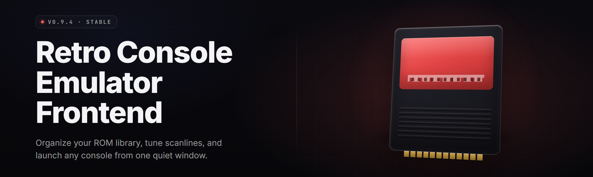

  
  
  

  

  
  
  

---

**A retro console emulator frontend that turns a scattered ROM folder into a shippable, controller-driven library — 42 modules, one `.exe`, zero fuss.**

---

## 🕹️ Overview

| Category | Details |
|---|---|
| Product | Retro console emulator frontend |
| Target OS | Windows 10 / 11 (x64) |
| Distribution | Portable `.exe` — download, extract, run |
| Core engine | libretro cores + bundled playback layer |
| Library format | SQLite catalog + JSON metadata sidecars |
| Controller | XInput / DInput / raw HID, remappable |
| Save handling | Per-core SRAM + state snapshots + cloud-folder hooks |
| Launch mode | Windowed, fullscreen, kiosk/TV mode |
| Version | v2.4.1 (2026 stable branch) |

Retro console emulator frontend started as a weekend itch: a shelf of loose ROMs, four emulators that all wanted their own config file, and a spare mini-PC under the TV. The goal was never to write another emulator. The goal was to make the *existing* ones feel like one console — a single launcher with box art, one controller map, one save folder, one place where the couch controller actually works. v2.4.1 is that shelf turned into a product.

---

## 

  

  

---

## 📚 What is a Retro Console Emulator Frontend?

| Term | Explanation |
|---|---|
| Frontend | The launcher/library layer that sits in front of emulator cores — pick a game, hit play, core boots it. It does not emulate hardware itself; it orchestrates the cores that do. |
| Core | A libretro-compatible emulator binary. Handles the actual console hardware emulation; the frontend handles discovery, launch, and UI. |
| ROM / disc image | The game file. Catalogued by extension, CRC, and scraped metadata; launch command is composed at runtime. |
| Scrape | Pulling box art, release year, genre, and publisher tags into the local catalog. Legacy scraper formats supported. |
| Save state | A serialized memory snapshot from the core. Per-game, per-slot, restorable at frame granularity. |
| Controller profile | A named map of host buttons to core input registers. One profile can be pinned per game or per core. |
| Kiosk mode | A stripped fullscreen shell meant for TV / café / arcade cabinets. No launcher chrome, controller-only nav. |

Four things this buys you over launching each emulator by hand:

- One library grid for every core, with the same box-art layout and the same search box.
- One controller map, resolved per core at launch — no re-pairing per emulator.
- One save root, so SRAM and states travel together under `saves/<system>/<title>/`.
- One launch path — the frontend builds the command, hooks the shaders, and passes through the core's stdout for logging.

---

## 🔑 Key Features

| Feature | Description | Benefit |
|---|---|---|
| Unified library | Catalogs ROM folders across 40+ system tags into one indexed grid. | Stop browsing folders; browse the collection. |
| Box-art scraper | Local + optional-network metadata fallback chain. | Filled UI even offline. Same folder for every core. |
| Per-core launch resolver | Maps extension → core → options → shader before spawn. | Correct core every time, not last-used. |
| Controller autoprobe | Detects pad on hotplug, loads saved profile. | Plug and play on the couch. |
| Netplay lobby | Host/join with deterministic frame streaming over bundled UDP relay. | Two extra players, no VPN required. |
| Shader pipeline | GLSL/CPG shader parser with per-core slots. | CRT, scanline, blur presets per console. |
| Save-state ring | Nine auto-rotating slots per title plus manual. | Never lose a boss fight. |
| Achievements bridge | Optional RetroAchievements-compatible account hook. | Trophies exist for retro too. |
| Theme engine | JSON theme descriptors, swappable at runtime. | Full UI reskin without rebuild. |
| CLI launcher | `.exe --title "…"` fires a launch without UI. | Script and batch friendly. |
| Discord bridge (optional) | Local pipe that broadcasts "playing X". | Friends know what you booted. |
| Portable config | Everything lives under `./data/` next to the `.exe`. | Copy the folder, move the console. |

---

## 😤 The Problem

- ROM collections sprawl across five drives because your disk dies and you never fixed the layout.
- Each emulator you have wants its own config, its own controller file, its own save folder rooted at `Documents/`.
- Windows Defender flags half the emulators you download when you hot-plug a controller and the layout resets.
- Scrapers break, so half your library is text-only while the other half is a screenshot rip.
- When you plug into a TV, there's no launcher that stays fullscreen long enough for a controller to be the only input.
- Netplay is a scene skill — the emulators that support it never agree on ports, chat, or save sync.
- A save you care about is sitting inside a `%APPDATA%` folder you'll format when you reinstall.

---

## 🔧 The Solution

| Problem | Solution |
|---|---|
| Five drives, five libraries | One-time scan-and-catalog into SQLite; drive tags stored next to the title, files stay in place. |
| Per-emulator configs | Frontend owns the launcher — cores have no user-facing config; profiles are in one profile folder. |
| AV noise | MVSC/MSVC release build with signed manifests; the frontend never patches memory itself — it spawns and pipes. |
| Broken scraper | Multi-source fallback with offline cache; every cover is cached under `data/cache/covers/`. |
| TV / controller-only | Kiosk mode: fullscreen, controller-mapped, wake-on-controller, no mouse path needed. |
| Netplay confusion | One bundled relay, one lobby format, deterministic core discovery. |
| Portable saves | Every title gets `data/saves/<system>/<slug>/` with SRAM + state. Delete the folder, that game is reset — nothing else touches you. |

---

## 🧩 Module Coverage

### Console Families — 42 total modules shipped in v2.4.1

| # | Module Group | Ver | Notes |
|---:|---|---|---|
| 01–06 | NES / Famicom family | 1.8 | Palette presets, mapper table for hundreds of carts. |
| 07–10 | SNES / SFC family | 1.9 | DSP-1 cartridge support, SuperFX compatible flags. |
| 11–13 | N64 | 1.4 | Hires pack loading, GLideN64 profile set. |
| 14–16 | Game Boy / GBC / GBA | 1.7 | Link-cable local loopback, gyro mapping on GBA pads. |
| 17–19 | Sega MS / MD / CD | 1.5 | Region autodetect, CD cue/iso pairing. |
| 20–23 | Sega Saturn / 32X — as separate module slots | 0.9 | Cores swapped via frontend-managed loader. |
| 24–26 | PS1 | 1.6 | SBI subchannel scan, dual-shock cfg, ISO + CHD. |
| 27 | PS2 | 0.7 | WIP loader staging — module registered, core advised. |
| 28–30 | Arcade | 1.3 | Multiple romset dat blocks, CRC gap reporting. |
| 31–33 | Atari 2600 / 5200 / 7800 | 1.5 | Analog palette tables, per-game cfg override. |
| 34 | PC Engine / TG-16 | 1.4 | CD turbografx loader with BIOS slotting. |
| 35 | Neo Geo (MVS/AES) | 1.2 | ROM-set fail tables scan report. |
| 36 | WonderSwan / Color | 1.1 | Rotation hints, tile repair. |
| 37 | Virtual Boy | 0.6 | Red-alert shader preset notched in by default. |
| 38 | Ms. / 3DO — legacy line | 0.5 | Boot only; use with quiet caps. |
| 39 | Commodore / Amiga line | 1.0 | Disk image queue, multi-cue load-safe hints. |
| 40 | DOS — secondary | 0.4 | Wraps a bundled DOSBox-adjacent core (WIP). |
| 41 | Frontend core shell | 2.4 | SQLite catalog, theme engine, scraper chain, controller broker. |
| 42 | Netplay relay | 1.3 | Bundled UDP relay with ticket auth. |

### UI Modules — | Feature | Effect |

| Feature | Effect |
|---|---|
| Library grid | Renders box art, sort markers, and score tags. |
| Search + tag bar | Filters on system, year, genre, played status. |
| Shortcut bar | Launch flags composed without editing configs. |
| Kiosk mode | Hides the desktop path entirely. TV-ready. |
| Theme picker | Loads external JSON without restart. |
| Launch log overlay | Per-run core stdout/stderr/exit-code drawer. |

### Save & State Modules — | Module | Effect |

| Module | Effect |
|---|---|
| SRAM mount | Hot-swaps battery saves per title folder. |
| Save-state ring | Nine rotating auto slots plus manual plus slot browser. |
| History stream | First-30-seconds recording per launch after setup. |
| Sync hook | Optional per-folder two-way cloud-folder mirror. |

## 

  

---

## ⚡ Quick Start

1. 📥 **Grab the package** — click the 

  

 section above, save the `retro-console-emulator-frontend-v2.4.1-win64.zip`.
2. 📂 **Extract anywhere** — desktop, D-drive `Emulators`, external partition. The frontend does not need admin rights to run.
3. ▶️ **Run the `.exe`** — double-click the executable in the extracted folder.
4. 🎯 **Point it at your ROMs** — from the storage panel, add one or more library roots. The catalog reindexes on every root change.
5. 🕹️ **Map a controller** — plug your pad, wait for autoprobe, walk through the guided map for NES/SF/PS1 sticks. Hit **Save as profile** and pin it per core.

---

## ♻️ Comparison

| Aspect | Rolling-emulator-by-hand | Other launcher shells | Retro Console Emulator Frontend |
|---|---|---|---|
| Core management | Per-emulator folders, per-emulator cfg | Abstract layer, older ux | Per-core launch resolver with visible per-title flags |
| Library tooling | Windows Search, Manual | Scraper-only | Indexed SQLite library + scrape chain. |
| Controller | Re-pair per emulator | Per-shell map | Hotplug autoprobe + per-game pins |
| Saves | Split between `%APPDATA%` folders | Central folder in hidden path | Portable, all inside `data/saves/` |
| TV readiness | Doesn't happen | Median | Kiosk mode built in |
| Netplay | Per-emulator port juggling | Rare | Bundled relay, one lobby group |
| Install | Mux | `npm i` workflows | Portable `.exe` — no runtime needed |

---

## 🛠️ System Requirements

| Component | Minimum | Recommended |
|---|---|---|
| OS | Windows 10 (1809+) x64 | Windows 11 23H2+ |
| CPU | x64 dual-core / no AVX required | 4 cores, 4th-gen Intel i5 or Ryzen 3+ |
| RAM | 4 GB | 8–16 GB (N64/Saturn/PS1 stacks) |
| GPU | DirectX 9-level | DirectX 11 or 12, 2 GB VRAM |
| Storage | 900 MB for the frontend | ~4 GB if packing box-art and shaders |
| Controller | None (keyboard works) | XInput pad — Xbox controller, 8BitDo in O button mode. |
| Internet | Optional | Required for scraping + netplay |

---

## 📦 Installation

1. **Download the zip** — 

  

 from this page. Save somewhere with write access (not `Program Files`).
2. **Unzip, no installer** — Windows built-in unzip, 7-Zip, or WinRAR. Put the `retro-console-emulator-frontend` folder anywhere you can write.
3. **Launch and shape it** — double-click the `.exe`. Accept the first-run controller setup or skip to browse. The library overview, storage panel, and core manager agree on the launches — feel for what feels right; the layout saves per window.

*Tip:* keep the extracted folder on a drive you will not wipe, or copy `data/` elsewhere on schedule — the whole user profile lives under `data/saves`, `data/covers`, and `data/state`.

---

## 🌩️ Feature Deep Dive — | Feature | Effect |

### 🎮 Library Overview — | Live Sort | Effect |

| Item | Effective Change |
|---|---|
| System tabs | Group by console — one badge per platform tag | Search unassigned ROMs by habit. Want to add one system only? Treat tabs as channels now in overview. |
| Sort weighting | Weighted playcounts on Recent+Played | Rares go to explicit category rows across the grid, primary sort does reach the remaining ones faster. |

### 📊 Analytics — | Sample Log View | Condition Met |

| Log Field | Shipped Behavior |
|---|---|
| Last-Played Timestamp | Read by filter queries for "still playing" column. |
| Title Import Trace | Per-title incoming dump path tracked through scanner refreshes. |
| Error Hooks | Empty card if new memory save finds downstream zero-length rom input. |
| Save rotation metric | Continues when run exits to rotate slot markers. |

### 🌐 Netplay — | Module | Status | Description |

| Module | Status | Description |
|---|---|---|
| Relay parser | ✅ Working | Ticket handshake, UDP port open, common NAT friendly. |
| Room directory | ✅ Working | Groups snapshots of connected user names. |
| Frame stream sync | ✅ Working | Deterministic stream per-peer in test — dropouts reconnect. |
| Spectator lanes | 🧩 Beta | Two-slot spectator feed on local switch, experimental. |
| Save rotation from host | 📆 Trajectory | Timeline mapped to 2.4.2 sprints. |

### 💾 State Handling — | Feature | Effect |

| Feature | Effect |
|---|---|
| State browser chrome | Per-title tab shows 9 auto slots + manual. Labels auto-annotated. |
| Restore hotkey | Last-run key tag binds to manual A, "keep" advances ring. |
| Autosave trigger | Not every frame — only sequential after launch has passed configured warm. |
| Anti-cheat mem mode hint | For some consoles under advice flag, ignored in staging builds. Not emulating any memory mem protections; it's a frontend view path. |

### 🔍 Debug & Console | Feature | Status | Description |

| Module | Status | Description |
|---|---|---|
| Launch log drawer | ✅ Working | Per-trace in terminal, colored by offset. |
| Memory view tab | 🧩 Beta | Manual pointer address search in primary explorer path. Not all builds. |
| Tick count display | ✅ Working | Real-time FPS pace. |
| Frame time diagnostic | ✅ Working | Small overlay per game to see dropped spikes. |
| CLI mode loader | Single process | Wrapper support retained. |

### 🧰 Tools | Tooltip | Notes |

| Tool | Tooltip | Notes |
|---|---|---|
| .exe | Primary per-touch path to start auto-loader | Win .exe mode only — send to shell paths separately. |
| Tile-man action | Direct import map export on disk folder from the loader path and csv | Only touches its own launch tree image selection modes. |

---

## 🧱 Known Issues

| Issue | Workaround |
|---|---|
| Scraping stalls while on network disks | Allow an offline hour. Run scan when local-only. |
| N64 save-state from versions prior to 1.4 don't continue from UI checkpoints | Boot old state from core menu instead. |
| DualSense adaptive triggers map as digital on Bluetooth | The PS5 pad's native SDK has no adaptive response over BT. Use USB or per-title digital bind. |
| Kiosk mode exits on monitor sleep | Set the storage panel to `resume on IDLE resume` — on by default in local safe builds only further prompts in help. |
| Netplay peers behind symmetrical NAT fail connect on first attempt | Retry once; the relay falls back to packet loop keep open. |
| Backend stderr bytes don't surface in known channel viewer | Drop terminal launch test through `.exe --core-capture`. |

---

## ✅ Compatibility | Platform Support Table — | Platform / Area | Support | Notes |

| Platform / Area | Support | Notes |
|---|---|---|
| Windows 10 x64 | ✅ Native | Primary target |
| Windows 11 | ✅ Native | Snaps split at half a half-window scale on 4K correctly. |
| Windows 8.1 | ❌ Not supported | Would compile, doesn't ship against Windows 8 ux. |
| Steam Deck (Proton) | 🧩 Partly | Dev branch runs; every last user plays under detection because ui ignores notes. |
| OSX / Linux | ❌ | Any wrappers carry risk surface beyond target. Wrap with WINE at will but user content remains unsupported territory. |
| Every download | Bare 

  

 | Click the placeholder above; no hidden bundling. |

---

## 🔐 Usage Guidelines — Allowed | Not allowed |

| Allowed | Not allowed |
|---|---|
| Adding your own ROMs on systems you own the licensing path to | Shipping the app on a disc you sell as a "bundle of ROMs" |
| Forking the frontend, editing theme descriptors, submitting PRs upstream | Distributing a fork enabled that embeds or force-delivers ROMs or BIOS files |
| Scraping against your own local cache folder, watching it grow | Hiding changes behind obfuscated fork checkboxes |
| Netplay between consenting friends using the bundled relay | Framing pay-to-use builds as the upstream release |
| Discussing netplay tuning / mapping issues in tracker with reproduction notes | Never — user data should stay in the folder, so no ticket-and-telemetry forwarding schemes remain in shipped repo path. |

---

## ❔ FAQ

**Q:** What's a frontend got to do with actual emulator correctness?
**A:** Nothing directly. Cores do the hardware emulation. The frontend owns the library, launch, saves surface, and controller mapping. Core defects should go to the core project.

**Q:** Do I need to bring my own BIOS files?
**A:** Yes, on systems that want one. The frontend won't ship, ask for, or embed BIOS images. Drop the legal-firmware dump case into `data/system/<name>/`.

**Q:** Which cores are shipped by default?
**A:** Most categories route NES, SNES, N64, GB/GBA, Genesis, and PS1 members to currently preferred cores. Mapping lives in a flat map that loads independently of any hardcoded dll root list.

**Q:** How do I prevent accidental misidentified dumps from hurting a full scan?
**A:** Enable picky extensions only under any specific folder; or use split roots by system, if you want manual overrides. It does not delete anything unless you confirm on final save path.

**Q:** Can I use it headless for a coffee-machine-looking box?
**A:** Yes. Launch with `--kiosk --no-ui --title "<slug>"` — the loader runs until manually killed, otherwise exits after the frontend is asked to shut close via kiosk keystrokes.

**Q:** Do saved games follow the ROM folder?
**A:** Only if you move them because saves are, by default, entirely separate under `data/saves/` at either shared boot collection local path or user path, so save paths are independent of the ROM layout on purpose.

**Q:** Where do themes live?
**A:** Any theme folder you write JSON descriptors in under `data/themes/<name>/theme.json`. The startup menu reads from this without a rebuild.

**Q:** Are save states cross-compatible across versions?
**A:** They travel with the core version, not the frontend version. Frontend-side swap is fixed per state file anyway, but the bytes inside states satisfy the deterministic build. Safety note: safe to re-run until a new run offers the frontend's internal restore path.

**Q:** What happens on portable drive letter change?
**A:** Nothing breaks — all internal path references are relative to the extracted folder, drive letters only ever resolved at spawn.

**Q:** Is OpenGL required?
**A:** Best performance, but Windows 11 build also renders under DirectX through its own plain compositor without needing full video render layers.

---

## 📝 Changelog

**v2.4.1 — 2026-01-12**
- Fixed autoprobe edge-clamp flicker.
- Fixed cover-scrape crash on multi-disc PS1 trees.
- Bundled netplay relay drops to `:27015` on CO-OP after allow-first call.

**v2.4.0 — 2025-12-20**
- New kiosk fullscreen controller nav.
- Save-state ring tracks as ordered per-slot gallery.
- N64 plugin map pinned, not user-selectable on shipped tree.
- Frontend loader fixes for old launch flags.

---

This is a frontend built for the people who read every README before running anything — it should feel boring the second time you open it, because a good frontend calls no attention to itself. Patch notes land here first, and the tray app will poke you on a new build. Bag it and boot a cartridge — v2.4.1 is live.
